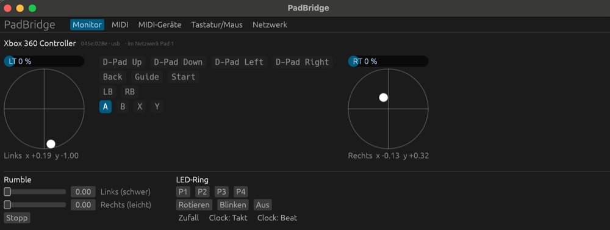
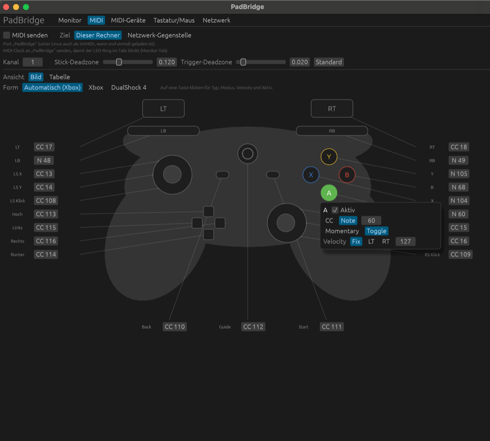
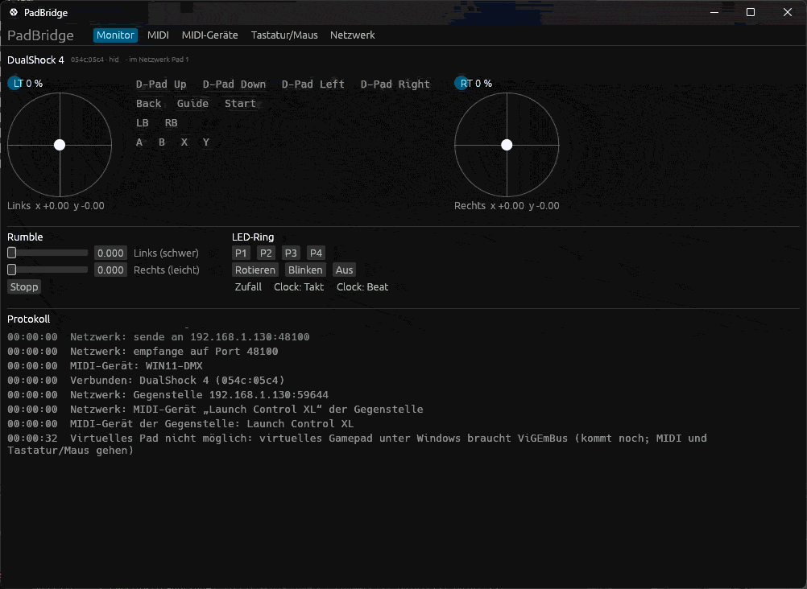
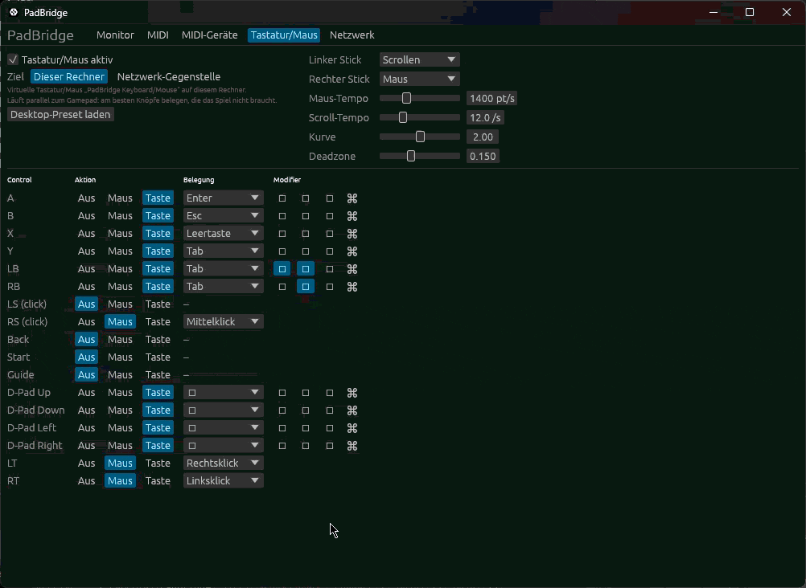
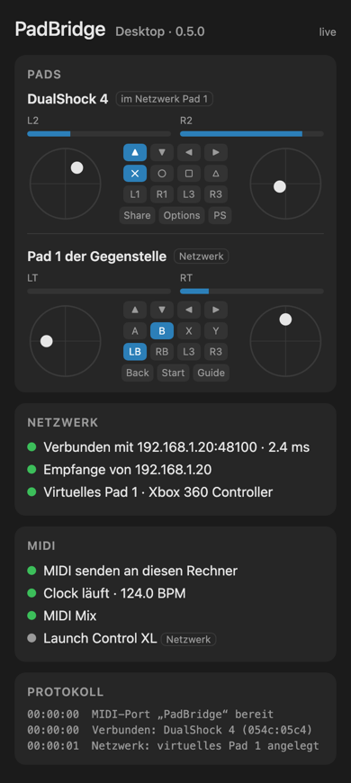

# PadBridge

Turn a game pad into a **MIDI controller**, a **keyboard/mouse**, or a
**network game pad** for another computer. Runs on **Linux**, on
**macOS 10.13 High Sierra and newer** (also on old Macs without Metal, it
runs on a 2010 iMac) and on **Windows 10/11**. No kernel extensions and no
drivers on the Mac. Ready-made downloads for all three are on the
[Releases](https://github.com/ThrowingSnow/PadBridge/releases) page.



Supported pads:

| Pad | macOS | Linux | Windows |
|---|---|---|---|
| Xbox 360 wired (and licensed clones) | USB, rumble, LED ring | USB, rumble, LED ring | XInput, rumble (Windows drives the LED ring) |
| Xbox One / Series and other XInput pads | – | see last row | XInput, rumble |
| DualShock 4 (PS4) | USB and Bluetooth, rumble, light bar | USB and Bluetooth, rumble, light bar | USB, rumble, light bar |
| Virtual pad for a peer | – (needs a driver) | uinput | ViGEmBus driver |
| Any other pad the Linux kernel knows | – | buttons, sticks, rumble | – |

## What it does

- **MIDI**: a virtual MIDI port "PadBridge". Every button, stick axis and
  trigger sends a CC or note of your choice: momentary or toggle, invert,
  deadzones, velocity fixed or from a trigger. Map it by clicking the
  controller picture: the outline of the pad in your hand, with a number
  field on every control that lights up when you press it.

  

- **MIDI devices**: PadBridge listens to MIDI controllers such as the
  Novation Launch Control XL, Akai MIDImix or APC mini mk2: a live drawing of
  the device, remapping, LED colours, and forwarding to the other computer.
- **MIDI clock in**: send clock to "PadBridge" and the LED ring (or the PS4
  light bar) blinks on the beat or steps through the bars.
- **Keyboard/mouse**: buttons become keys, a stick becomes the mouse.
- **Network**: send the pad, MIDI and keyboard/mouse to another machine over
  UDP (signed with HMAC-SHA256). On Linux and Windows the receiver creates a
  virtual Xbox 360 pad that Steam, SDL, Wine/Proton and Sunshine/Moonlight
  recognise without any setup. Rumble from the game goes back to the pad in
  your hand. The receiver shows the peer's pads live and can even turn them
  into MIDI with its own mapping.
- **Status page for your phone**: switch it on, scan the QR code, and see
  pads, link, latency and MIDI devices live in the browser. Free in the home
  network; from outside (e.g. Tailscale) it asks for a PIN.
- **Both directions at once**: every installation can send and receive. Play
  on the Linux box with a pad on the Mac, or play Bitwig on Linux with
  MIDI-learn from a pad on the laptop.

```
 Laptop / Mac                                  Linux desktop
 ┌──────────────────────┐   UDP 48100,         ┌─────────────────────────────┐
 │ pad (USB/Bluetooth)  │   HMAC-signed        │ virtual Xbox 360 pad        │
 │ MIDI port "PadBridge"│ ───────────────────► │ ALSA MIDI port "PadBridge"  │
 │ keyboard/mouse       │ ◄─────────────────── │ virtual keyboard/mouse      │
 │ LED ring, rumble     │  rumble, MIDI clock  │ (games, Bitwig, Moonlight)  │
 └──────────────────────┘                      └─────────────────────────────┘
```

On Windows the virtual pad needs the free
[ViGEmBus](https://github.com/nefarius/ViGEmBus/releases) driver. A Mac as
receiver accepts MIDI and keyboard/mouse; a virtual game pad would need a
driver there.

## In action

A DualShock 4 on Windows: live in the monitor, then as a MIDI controller in
the picture view, its MIDI going to the Mac over the network:



The pad as mouse and keyboard on Windows:



The status page on a phone (sample data):



## Getting started

Download the build for your system from
[Releases](https://github.com/ThrowingSnow/PadBridge/releases).

**macOS**: unzip and move `PadBridge.app` to Applications. It is ad-hoc
signed: on the first start, right-click it and choose "Open". For
keyboard/mouse output, allow PadBridge under System Settings → Privacy &
Security → Accessibility.

**Linux**: runs on Ubuntu 20.04 and newer, Debian 11+, Mint, Zorin, Pop!_OS,
Arch and Fedora.

```sh
tar xzf padbridge-<version>-linux-x86_64.tar.gz
install -Dm755 padbridge-<version>-linux-x86_64/padbridge ~/.local/bin/padbridge
padbridge
```

Add yourself to the `input` group and allow `/dev/uinput`; the udev rules for
that and for the LED ring and light bar are in [DOC.md](DOC.md).

**Windows**: put the `.exe` in a folder of its own and start it. It is not
signed: if SmartScreen warns, click "More info" → "Run anyway"; allow it in
the firewall prompt for private networks. Windows has no virtual MIDI ports
without a driver, so create them in
[loopMIDI](https://www.tobias-erichsen.de/software/loopmidi.html): one named
exactly `PadBridge` (pads → DAW), optionally `PadBridge In` (DAW → PadBridge,
e.g. MIDI clock); start PadBridge after loopMIDI. For a virtual pad from a
peer, install [ViGEmBus](https://github.com/nefarius/ViGEmBus/releases).

**Network**: both sides need the same key. In the "Netzwerk" tab click
"Schlüssel kopieren" on one machine and paste it on the other ("Übernehmen").
Enter the other machine's address on the sending side and switch on
receiving on the other. Only use it in your LAN or over a VPN such as
Tailscale: packets are signed, not encrypted.

**Headless service on Linux** (receives only, no window; a window opened
next to it takes over receiving while it is open):

```sh
cp app/padbridge.service ~/.config/systemd/user/
systemctl --user enable --now padbridge
```

**Building from source**: needs a current Rust from [rustup](https://rustup.rs)
(distribution packages of Ubuntu/Debian are too old).

```sh
git clone https://github.com/ThrowingSnow/PadBridge.git
cd PadBridge/rust
cargo build --release -p padbridge   # Linux: needs alsa-lib / libasound2-dev
scripts/bundle-macos.sh              # macOS app bundle
scripts/build-windows.sh             # Windows .exe, cross-built (mingw-w64)
scripts/build-linux.sh               # portable Linux binary (Docker)
```

Step-by-step setup, troubleshooting and the udev rules are in
**[DOC.md](DOC.md)** (German).

The user interface is in German for now.

## Project layout

```
rust/      the app (Linux, macOS 10.13+, Windows), see rust/README.md
  core/    pads, mapping, MIDI clock, LED logic, network protocol (no OS access, unit tested)
  app/     engine + egui window; platform/linux, platform/macos and platform/windows backends
docs/      images for this page
Sources/   the original Swift app (macOS 13+, Xbox 360 only), superseded by rust/
linux/     padbridge-netpad, the original Linux receiver, superseded by rust/
```

The Swift app and `padbridge-netpad` still work and speak the same protocol,
so old and new parts understand each other.

## Roadmap

- The receiving side shows the pad you actually hold (e.g. a PS4 pad instead
  of the Xbox 360 stand-in)
- Battery level of wireless pads, also on the status page
- An LED editor with more colours for the PS4 light bar
- Profiles, switched from the pad

Changes per version: [CHANGELOG.md](CHANGELOG.md).

## License

MIT, see [LICENSE](LICENSE).
